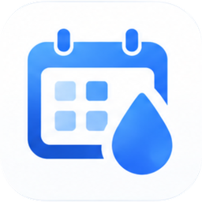
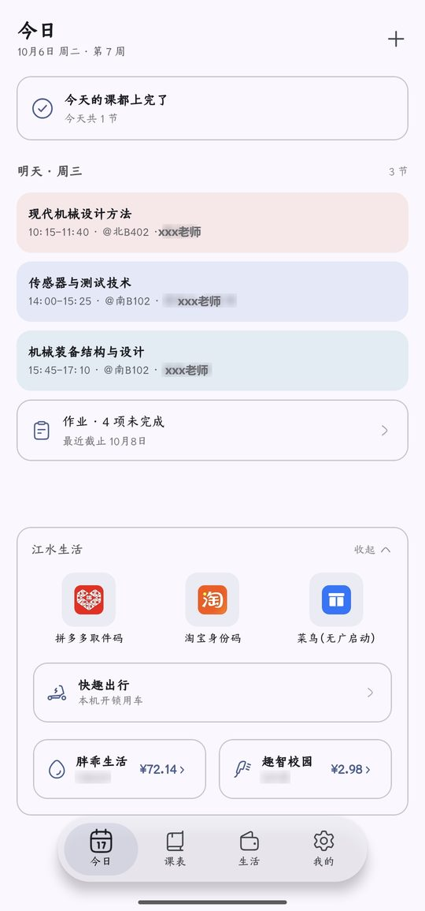
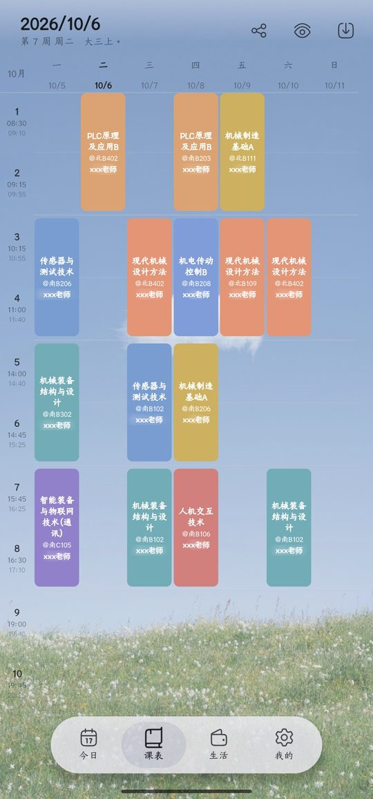
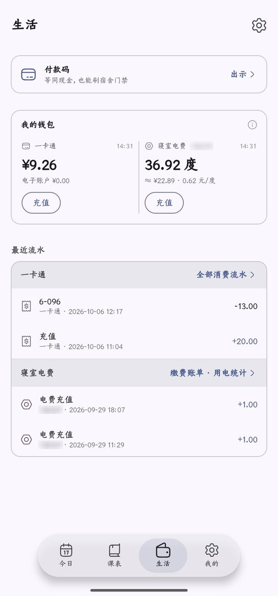

<p align="center">
  
</p>

<h1 align="center">水贝贝（JUWP Schedule）</h1>

<p align="center">
  江西水利电力大学校园生活 App —— 从教务一键导入课表，查询成绩与考试安排；顺手把学生每天要开的那些应用、网页和小程序收进一个应用里。免费、无广告、无内购。
</p>

<p align="center">
  <a href="https://github.com/Inonvation/JUWP-Schedule/releases/latest"></a>
  <a href="#-下载与安装"></a>
  <a href="LICENSE"></a>
</p>

<p align="center">
  
  
  
  <br>
  <sub>今日 · 课表 · 生活 —— 截图中的教师名与寝室房号已打码</sub>
</p>

> **非学校官方应用**，学生自用学习项目，详见文末[免责声明](#-免责声明)。

## ✨ 功能一览

- **课表** — 导入、教材、调课检测、上课提醒
- **成绩 · 考试 · 学业** — 成绩绩点、出分提醒、盖章成绩单
- **一卡通** — 余额充值、付款码、流水、电费充值
- **胖乖生活** — 扫码取开水、余额、账单、充值
- **趣智校园** — 蓝牙开热水、余额、账单、充值
- **快趣出行** — 地图找车、扫码开锁、免费时长提醒
- **U净** — 扫码下单、支付宝支付、完成提醒
- **百宝箱** — 图片水印、长图拼接、活动截图、菜鸟批量查
- **取快递** — 拼多多取件码 / 淘宝身份码 / 菜鸟取件码
- **教务** — 校历、请假、宿舍报修
- **其他** — 选课、笔记作业、收件箱、小组件、备份

## 📥 下载与安装

从 **[Releases](https://github.com/Inonvation/JUWP-Schedule/releases/latest)** 下载最新正式包 `JUWP-Schedule-<版本号>.apk`，Android 8.0 及以上可用，约 5 MB。

## 🔒 数据与隐私

- 不设账号体系，**不向任何服务器上传数据**，内容只留本机；凭证用 Android Keystore 加密存储，已排除云备份。
- 保存凭证只为登录过期时自动续登，随时可在「我的」退出登录并清除。

## 🛠 开发

环境：JDK 17 · Android SDK 35 · Gradle Wrapper 8.10.2（随仓库配置，minSdk 26 / targetSdk 35）。

```bash
./gradlew.bat :app:testDebugUnitTest :app:assembleDebug   # 单测 + Debug 包
./gradlew.bat :app:assembleRelease                        # R8 + 签名
```

架构、教务解析、WebView 导入与换校适配见 **[DEVELOPER.md](DEVELOPER.md)**；爬虫脚本见 **[scripts/README.md](scripts/README.md)**。

## 🏫 换学校适配

> [!NOTE]
> 只适配江西水利电力大学，**暂无适配其他学校的计划**。想给自己学校做定制版可以 fork，按 [DEVELOPER.md](DEVELOPER.md) 的「换一所学校：适配指南」替换教务地址、页面结构与品牌信息即可。

## 🙏 参考与致谢

- [kqcx-bikemap](https://github.com/dlkz/kqcx-bikemap) — 快趣出行车辆接口
- [拾光课程表](https://github.com/XingHeYuZhuan/shiguangschedule) — 课表 JSON 互通格式
- [light-life](https://github.com/Inonvation/light-life) — 胖乖生活（开水）协议
- [linyu](https://github.com/yehu-imei/linyu) — 趣智校园接口
- [quzhi-lite](https://github.com/wzk-chi/quzhi-lite) — 趣智校园接口
- 等

## ⚠️ 免责声明

> [!WARNING]
> 本项目为学生自用学习项目，**非学校官方应用**，与江西水利电力大学无任何隶属或合作关系。
>
> - 登录教务、调用胖乖生活、趣智校园、快趣出行、U净与校园卡一卡通等接口，均模拟正常客户端操作，存在账号与接口变更风险，使用后果自负。
> - 校园卡付款码**等同现金**：仅限本人使用，请妥善保管好隐私凭据等信息，请勿截图或分享给他人，泄露可能被盗刷；因启用相关功能造成的损失，开发者本人概不负责。
> - 严禁滥用：刷积分、绕过付费、伪造官方身份、售卖本软件及其脚本、攻击学校网站、爬取售卖敏感数据、逆向学校官网或教务系统。
> - 项目仅供学习交流使用；如因不正当使用造成任何损失，本人概不负责。如有侵权，请联系删除。

问题、建议或想新增功能，欢迎提 [Issue](https://github.com/Inonvation/JUWP-Schedule/issues)。

## 📄 License

[MIT](LICENSE)
