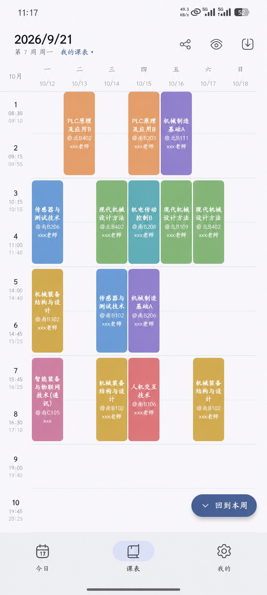

# JUWP Schedule（水贝贝）

江西水利电力大学的课表 Android App —— 水专也有自己的 App 了！

[](https://github.com/Inonvation/JUWP-Schedule/actions/workflows/android-ci.yml)
[](LICENSE)

 

> **非学校官方应用**，学生自用学习项目，详见文末[免责声明](#免责声明)。

## 已实现的功能

课表导入（理论 + 实验） ·校园一卡通付款码 · 寝室电费查看与充值 · 胖乖开水 · 趣智开热水 · 快趣出行 · U净洗衣房 · 考试安排 · 成绩与绩点 · 学业达成 · 出分/考试提醒 · 选课（beta） · 校历 · 学工表单（宿舍报修/请假） · 盖章成绩单 · 取快递 · 等 

## 下载

从 **[Releases](https://github.com/Inonvation/JUWP-Schedule/releases/latest)** 下载最新正式包（资产名 `JUWP-Schedule-<版本号>.apk`）。

- 应用完全免费、无广告、无内购；**只从本仓库的 Release 下载**，其他渠道流传的安装包与本项目无关

## 功能

**课表**

- 一键从教务导入：自动依次读取并导入**理论课表**与**实验课表**
- 导入后自动抓取本学期对应课程**教材**，可在课程详情里查看
- **调课检测**：教务课表有变动时发通知，处置页逐条勾选合并或忽略；默认关闭，绝不后台静默改课表
- 上课提醒、系统日历同步、手动调课规划、自定义背景图

**成绩 · 考试 · 学业**

- 一键导入全部学期成绩，按学期 / 学年分组，自动计算加权平均分与平均绩点
- 学业完成情况：培养方案达成度按课程体系 / 性质 / 属性 / 公选课四维度展示（要求 / 已修 / 在修 / 还需学分）与课程明细
- 出分提醒与考试变动提醒：教务一出分、考试有调整就收通知，自动检查、间隔可调
- 盖章成绩单：从教务签章系统导出带学校电子章的 PDF 成绩单，可重看或分享

**选课（beta）**

- 选课记录（教务选课日志）与选课轮次一览，轮次开始前 30 分钟 / 截止前 6 小时各提醒一次
- 预选清单：选课开放前录好想选的课，带「已选 / 课表已有」防重复对照；支持自动抢课（间隔可调、只加课不退课、接口在选课窗口期接入）
- 应用内选课中心：浏览、筛选、选课与退课都在 App 内完成（退课逐次确认），教务网页仅作备用入口

**笔记与作业**

- 笔记·课件：按课程归类，Markdown 正文 + TeX 公式，可插入图片
- 作业清单：按课程分组记录截止日期与完成状态，截止前一天与当天 20:00 各提醒一次未完成的

**生活与服务**

- 生活页：一卡通余额、付款码、**寝室剩余电量**、充值入口与最近流水一页收齐；电费充值可选**电子账户**或**农行支付**（收银台内嵌，卡号与验证码只在银行页面输入），每个充值入口先过风险提醒；可在设置关闭此页
- 校园卡付款码：一键出示，可查余额与历史账单，消费流水标注充值到账账户；今日页顶栏「+」还有**扫一扫**与**付款码**两个快捷入口
- 胖乖生活：一键开水、余额查询、订单记录
- 趣智校园：**开热水**——登录、余额充值、账单、扫码绑定热水器，开阀与结算都在 App 内完成（协议来自公开逆向资料，非官方功能）
- 快趣出行：微信小程序 / 快趣账号两种用车方式，账号档可在 App 内开锁、临时锁车与还车；内置地图看附近车辆、还车点与禁停区，扫码后自动开始免费时长倒计时（15 分钟）并提醒
- U净 洗衣房：空闲看板、扫码选档下单、支付宝支付、订单倒计时、**洗涤完成提醒**与本机历史账单
- 校历：免登录查看本学年校历，公开仓库镜像自动更新，无需等发版
- 学工表单：宿舍报修、请假在 App 内填写、传附件、提交与查进度（统一认证，与教务同账号）
- 取快递快捷方式：一键直达拼多多取件码、淘宝身份码与菜鸟（无广告启动）

**桌面小组件**

- 课表 / 校园卡·电费两条目；胖乖开水 / 趣智开水两枚固定 2×2 卡（点胶囊直接开始）
- 小组件自身不联网取数，读数跟随 App 内更新；校园卡余额可在设置隐藏

**导入与备份**

- 课表、学期配置、作息、成绩与学业完成情况支持 JSON 备份，可随时导出与导入；笔记与作业不在该份备份里

## 使用

| 要做什么 | 去哪里 |
|----------|--------|
| 导入课表 / 成绩 / 考试 | 我的 → 教务，或对应页面内导入 |
| 成绩 / 学业 / 笔记 / 作业 / 选课 | 我的 → 学习 |
| 调课检测 | 我的 → 课表 → 调课检测（默认关） |
| 盖章成绩单 | 我的 → 教务 → 导出盖章成绩单 |
| 桌面小组件 | 我的 → 提醒与桌面 → 桌面小组件 |
| 主题配色 / 生活页开关 | 我的 → 通用设置 |
| 快趣出行 / 趣智校园 / U净 / 校历 | 我的 → 校园服务 |
| 免责声明 / 充值风险提醒 / 开源许可 | 我的 → 关于 |

---

# 开发

整体架构、教务爬虫解析、WebView 导入实现与换校适配步骤，见开发者文档 **[DEVELOPER.md](DEVELOPER.md)**。

## 环境要求

| 项 | 要求 |
|----|------|
| JDK | 17+ |
| Android Studio | Koala / Ladybug 及以上 |
| Android SDK | Platform 35，Build-Tools 35.x |
| Gradle / Kotlin | Wrapper 8.10.2 / 2.1.21（已随仓库配置） |
| minSdk / targetSdk | 26 / 35 |
| applicationId | `edu.jxslu.schedule`（debug 变体加 `.debug` 后缀，可与正式包共存） |
| CI | GitHub Actions：单测 + Debug 组装 + Release 组装（R8 冒烟），见 `.github/workflows/android-ci.yml` |

## 构建与测试

```bash
./gradlew.bat :app:testDebugUnitTest :app:assembleDebug
# APK: app/build/outputs/apk/debug/app-debug.apk

./gradlew.bat :app:assembleRelease
# APK: app/build/outputs/apk/release/app-release.apk（R8 压缩 + 签名）
```

单测结果汇总在 `app/build/test-results/testDebugUnitTest/`。本机依赖齐备后可加 `--offline`，构建快一个量级；改过混淆规则要装 release 包冒烟。

## 参考

- 快趣出行车辆接口参考：https://github.com/dlkz/kqcx-bikemap
- 趣智校园接口参考：https://github.com/yehu-imei/linyu 、https://github.com/wzk-chi/quzhi-lite
- 拾光课程表：https://github.com/XingHeYuZhuan/shiguangschedule
- 胖乖参考实现：https://github.com/Inonvation/light-life
- HugeIcons Compose：`com.github.rikkahub:hugeicons-compose`（JitPack）
- 地图瓦片：osmdroid 6.1.18（`org.osmdroid:osmdroid-android`）
- 桌面小组件：Glance `androidx.glance:glance-appwidget` 1.2.0

## 免责声明

本项目为学生自用学习项目，**非学校官方应用**，与江西水利电力大学无任何隶属或合作关系。

- 登录教务、调用胖乖生活、趣智校园、快趣出行、U净（美的校园洗衣）与校园卡（一卡通）接口等行为均模拟正常客户端操作，存在账号与接口变更风险，使用后果自负。
- 应用不上传任何数据到第三方服务器；教务与校园卡凭证仅保存在本机（Android Keystore 加密存储，已排除云备份），凭证不写入代码仓库。保存凭证的用途只有一个：登录状态过期时自动重新登录，省去反复手动输入；随时可在「我的」页退出登录并清除。
- 校园卡付款码等同现金：仅限本人使用，请妥善保管好敏感凭据信息。请勿截图或分享给他人，泄露可能被盗刷；若因启用相关功能造成损失，开发者本人概不负责。
- 严禁将本项目用于刷积分、绕过付费或任何伪造官方身份的用途。
- 禁止在学校（含江水及其他任何学校）内售卖该软件及其脚本，一经发现将永久删除此仓库，由此造成的损失本人概不负责。
- 严禁将本项目分享的脚本用于攻击学校网站、爬取售卖本校敏感数据、逆向学校官网或教务系统等违规违法行为。
- 项目仅供学习交流使用；如因不正当使用造成任何损失，本人概不负责。如有侵权，请联系删除。

## License

[MIT](LICENSE)
